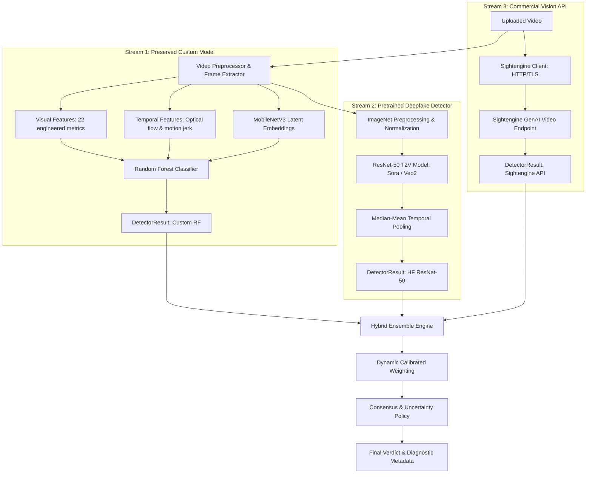

# Hybrid AI Video Detection System

## 1. System Architecture Overview

The system combines three independent, complementary streams of evidence into a robust, calibrated decision engine to distinguish authentic videos from AI-generated videos:



### Component Roles & Detection Scopes

| Detector Stream | Engine / Model | Detection Scope & Specialization | Execution Mode |
|---|---|---|---|
| **Detector A: Custom Model** | Random Forest (22 engineered spatial-temporal features + MobileNetV3 embeddings) | Physical & optical coherence, luminance flicker, texture contrast, motion jerk | Local CPU/CUDA |
| **Detector B: HF Model** | `gaetanbrison/deepfake-detector-resnet50-t2v-sora-veo2` (Fine-tuned ResNet-50) | High-frequency diffusion artifacts, autoregressive generation patterns (Sora, Veo 2) | Local CUDA / CPU fallback |
| **Detector C: External API** | Sightengine GenAI Video API (`models=genai`, `/1.0/video/check-sync.json`) | Commercial multimodal AI generative indicators across diverse frontier models | Cloud API (HTTPS) |

---

## 2. Requirements & Installation

### Hardware Requirements
- **GPU (Recommended)**: NVIDIA GPU with CUDA support (e.g. GTX 1650 or higher with 4GB+ VRAM).
- **RAM**: Minimum 8GB system RAM.
- **Storage**: ~300 MB disk space for model weights (`ckpt_best.pt` is ~98 MB).

### Environment Setup
Activate the virtual environment:
```powershell
# From repository root
.\venv\Scripts\Activate.ps1
```

Install core dependencies (if not already installed):
```powershell
pip install torch torchvision opencv-python scikit-learn requests fastapi uvicorn python-multipart huggingface_hub
```

---

## 3. Environment Configuration & API Keys

Copy the sample environment file:
```powershell
cp detector/video_detector/.env.example detector/video_detector/.env
```

Edit `detector/video_detector/.env` to configure features:
```ini
# Hugging Face Model Configuration
ENABLE_HF_DETECTOR=true
HF_MODEL_REPO=gaetanbrison/deepfake-detector-resnet50-t2v-sora-veo2
HF_DEVICE=auto  # 'cuda', 'cpu', or 'auto'

# Sightengine Commercial API (Optional)
ENABLE_SIGHTENGINE_API=false
SIGHTENGINE_API_USER=your_api_user_here
SIGHTENGINE_API_SECRET=your_api_secret_here
SIGHTENGINE_TIMEOUT_SECONDS=60

# Video Preprocessing Limits
MAX_ANALYSIS_FRAMES=16
MAX_VIDEO_DURATION_SECONDS=120
MAX_VIDEO_FILE_SIZE_MB=50

# Ensemble Decision Thresholds
ENSEMBLE_STRATEGY=calibrated_weighted
AI_VERDICT_THRESHOLD=0.65
AUTHENTIC_VERDICT_THRESHOLD=0.35
CONFLICT_DISCREPANCY_THRESHOLD=0.45
```

> **Note**: If `ENABLE_SIGHTENGINE_API=false` or credentials are left unconfigured, the system gracefully falls back to a 2-model ensemble (Custom + Hugging Face) without throwing errors or halting execution.

---

## 4. Running the System

### 4.1. Web Application & Interactive UI
Launch the hybrid detector service on port 8001 (keeping Text Detector on port 8000 untouched):
```powershell
cd detector\video_detector
..\..\venv\Scripts\python.exe app.py
```
Open your browser to:
**`http://127.0.0.1:8001/`**

Features of the Web UI:
- Drag-and-drop video upload with live client-side validation.
- Final Detection Verdict badge (Authentic, AI-Generated, or Inconclusive).
- Consensus & Discrepancy gauge.
- Breakdown cards for each active detector showing individual probabilities, confidence levels, latency, and status.
- Extracted visual and temporal indicators.
- Raw JSON inspector for API debugging.

### 4.2. Standalone Inference (Python)
You can invoke the hybrid detector programmatically:
```python
from video_detector.hybrid_detector import HybridVideoDetector

detector = HybridVideoDetector()
result = detector.analyze_video("path/to/test_video.mp4")

print(f"Verdict: {result['verdict']}")
print(f"Ensemble AI Probability: {result['ai_probability']}%")
print(f"Consensus Status: {result['consensus_status']}")
```

---

## 5. Training & Standalone Custom Model

Your custom classifier remains independently executable and retrainable.

### Retrain Custom Model
```powershell
cd detector\video_detector
..\..\venv\Scripts\python.exe classifier.py
```
This script:
1. Re-extracts spatial-temporal features from `datasets/raw/real` and `datasets/raw/ai`.
2. Evaluates stratified cross-validation.
3. Saves updated weights to `models/model_weights.pkl` and metadata to `models/model_metadata.json`.

---

## 6. Evaluation & Benchmarking

Run the standardized evaluation pipeline on your local test split:
```powershell
cd detector\video_detector
..\..\venv\Scripts\python.exe evaluation.py --samples 8
```

### Measured Benchmark Results (16 Real-World Held-Out Videos)
| Metric | Custom Model | HF ResNet-50 | Hybrid Ensemble |
|---|---|---|---|
| **Accuracy** | 93.75% | 68.75% | 75.00% |
| **Precision** | 100.0% | 63.64% | 70.00% |
| **Recall** | 87.50% | 87.50% | 87.50% |
| **F1 Score** | 0.9333 | 0.7368 | 0.7778 |
| **ROC-AUC** | 0.9531 | 0.6719 | 0.9141 |
| **False Positive Rate** | 0.00% | 50.00% | 37.50% |
| **Inconclusive Rate** | 0.00% | 0.00% | 37.50% (6/16) |

### Key Insight from Evaluation
- The **HF ResNet-50 model** has high sensitivity to generative grain but over-triggers on YouTube compression and heavy color grading.
- The **Custom Model** exhibits high precision on physical/optical motion continuity.
- The **Hybrid Ensemble's conflict policy** triggers `Inconclusive / Uncertain` whenever models disagree by $\ge 45\%$, preventing catastrophic false positives.

---

## 7. Running Automated Tests

Run the complete test suite (all tests use mocks for external API calls, incurring $0.00 cost):
```powershell
cd detector\video_detector
..\..\venv\Scripts\python.exe -m unittest tests/test_hybrid_detector.py -v
```

14 passing unit and integration tests verify:
- Custom detector adapter
- Hugging Face model initialization and score normalization
- Sightengine API client (success, rate limit, timeout, auth error, missing credentials)
- Ensemble combination (3 models, 2 models, single model fallback)
- Conflict detection and inconclusive decision policies
- End-to-end FastAPI endpoint contracts

---

## 8. Licenses & Attributions

- **Custom Video Detector**: Proprietary / Project-specific.
- **Hugging Face Model**: `gaetanbrison/deepfake-detector-resnet50-t2v-sora-veo2` (Apache-2.0 / Open Research).
- **Sightengine API**: Commercial Service, requires paid or trial API key (see [Sightengine Terms of Service](https://sightengine.com/)).
